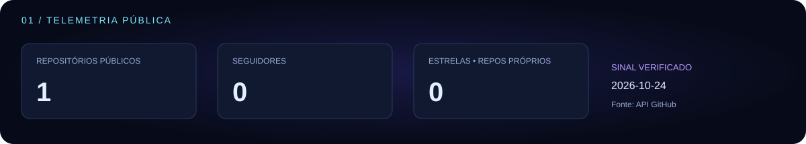
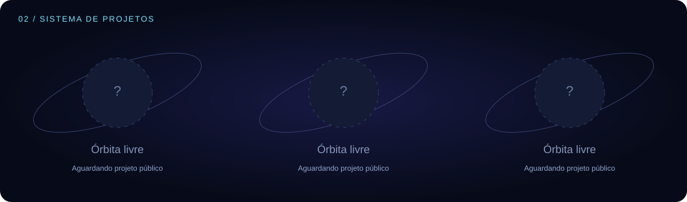

<!-- Gerado por scripts/update.mjs; edite o gerador para personalizar. -->
# kinm-LC · Orbital

Ainda não há projetos públicos próprios para exibir.

[Explorar repositórios](https://github.com/kinm-LC?tab=repositories)

Dados consultados em **2026-10-21T07:09:03.404Z**. Repositórios e seguidores: API pública. Estrelas: soma dos repositórios próprios, sem forks. Projetos: até três repositórios próprios não arquivados, excluindo este perfil, por estrelas e último push.

Calendário: Contribuições retornadas pelo GitHub • últimos 12 meses. O cometa é uma animação decorativa; não altera os dados. Animações SVG dependem do visualizador; os painéis permanecem legíveis sem movimento.
